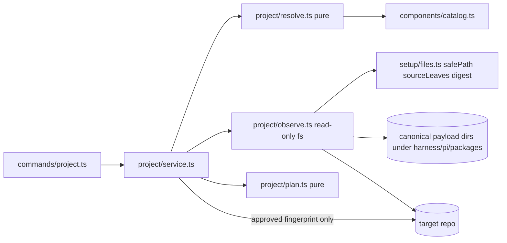

# Project capabilities (`ae project`)

**Architecture Gate:** `APPLIES` — new runtime behavior, several cooperating modules, persisted state (a local receipt), filesystem authority boundaries, and an authored-catalog/consumer relationship.

**Lifecycle status (per [`workbench/handbook/16_SUBSTANTIAL_SUBSYSTEM_LIFECYCLE.md`](../workbench/handbook/16_SUBSTANTIAL_SUBSYSTEM_LIFECYCLE.md)):** IMPLEMENTATION, TESTS, VALIDATION and independent ARCHITECTURE REVIEW **PASS** at executable commit `e6b42ab448c5c8bc2faf59785795c8ab4758ea80`. Main and the fresh reviewer each ran check/build/144 tests, zero failures/skips. The [retained review](../plans/handoffs/PROJECT_CAPABILITY_REVIEW.md) records the initial two material findings and their passing delta re-review; both fixes have independently mutation-tested regressions. Architecture documentation and its path/symbol/link validation are completed by Main in this documentation checkpoint; final publication and machine evidence are in the [closure acceptance report](../plans/handoffs/FINAL_CONSOLIDATION_ACCEPTANCE.md).

## What this is

A deliberately small vertical that installs a *project-level* capability into one explicit existing Git repository: it links canonical Pi Skill payloads from this checkout into the project's `.pi/skills/` and records a local receipt. It is independent of machine `setup` (no Homebrew, Stow, Pi installation, HOME, or installer) and is not a workflow engine, registry or controller. The CLI user guide is [`cli/README.md`](../cli/README.md#project-capabilities).

## Components and ownership



| Responsibility | Owner |
|---|---|
| Capability definitions, project applicability, compositions, dependency edges | `projectLeaves`, `compositions`, `projectCatalog` in [`cli/src/components/catalog.ts`](../cli/src/components/catalog.ts) (single authority; `Component.project` in [`cli/src/setup/types.ts`](../cli/src/setup/types.ts)) |
| Recursive graph resolution, cycle/unknown/non-project rejection | `resolve` in [`cli/src/project/resolve.ts`](../cli/src/project/resolve.ts) |
| Target validation, lazy source inspection, receipt read/validation, ownership observation | `projectTarget`, `leafEntries`, `readReceipt`, `buildReceipt`, `observe` in [`cli/src/project/observe.ts`](../cli/src/project/observe.ts) |
| Deterministic plan, conflicts, fingerprint, next receipt | `planProject` in [`cli/src/project/plan.ts`](../cli/src/project/plan.ts) |
| Orchestration, apply effects, verification, inspection, discovery | `previewProject`, `applyProject`, `verifyProject`, `inspectProject`, `listProject`, `context` in [`cli/src/project/service.ts`](../cli/src/project/service.ts) |
| Argument parsing and rendering only | `project` in [`cli/src/commands/project.ts`](../cli/src/commands/project.ts), dispatched from [`cli/src/index.ts`](../cli/src/index.ts) |
| Shared path-safety and source-walk mechanisms (reused, not duplicated) | `safePath`, `sourceLeaves`, `digest`, `stat` in [`cli/src/setup/files.ts`](../cli/src/setup/files.ts) (`sourceLeaves` was only widened to `Pick<…>` parameters) |

Authored vs generated: catalog entries and canonical payloads are authored; links and `.ae/project-capabilities.json` in a target project are machine-local derived state, never canonical. `cli/dist/` is build output.

## Execution flow

```mermaid
sequenceDiagram
    participant U as Operator
    participant S as service
    participant O as observe
    participant P as planProject
    U->>S: plan --target --select
    S->>S: context() validates target; resolve() expands selection
    S->>O: readReceipt, observe(selected leaves only)
    S->>P: resolution + observations + receipt text
    P-->>U: operations, conflicts, fingerprint (nothing written)
    U->>S: apply --approve FINGERPRINT
    S->>S: recompute the same plan; refuse conflicts, missing or stale approval
    S->>S: mkdir (non-recursive), symlink (no clobber), receipt tmp+rename
    S->>O: verifyProject on the selection
    S-->>U: applied operations + verification
```

Call map: `project()` → `context()` → `projectTarget()`; `previewProject()` → `resolve()`, `readReceipt()`, `observe()` → `leafEntries()` → `sourceLeaves()`, then `planProject()`; `applyProject()` → `previewProject()` → effects → `verifyProject()`.

## Data and state

- **Input:** catalog (`projectCatalog(root)`), a selection of IDs, an absolute real target path, an approval fingerprint.
- **Entry:** a leaf expands to one entry per regular file under its canonical source directory: `{ relative (project path), source (repo-relative), sha256 }`. Only leaves in the resolved selection are read (*selected-only lazy inspection*; tested by removing an unselected leaf's source).
- **State:** the only persisted state is `.ae/project-capabilities.json` (schema 1): source checkout realpath, sorted selection, per-leaf entries, and an `integrity` digest over the other fields. No timestamps, so reruns are byte-stable. It records provenance; it is not the ownership authority.
- **Ownership truth:** a target is owned only if it is a literal symlink resolving to exactly its canonical source file. Anything else existing is *foreign* and preserved.
- **Fingerprint:** SHA-256 of target, source root, selection, order, operations, conflicts and receipt before/after digests. It serves as the explicit approval token, so any change in target, receipt or canonical source content invalidates it.

## Authority boundaries and failure behavior

| Situation | Behavior |
|---|---|
| Target missing, symlink, under a symlink, not a `.git` repository root, or inside/equal to the canonical checkout | Command error; nothing touched |
| Parent inside project is a symlink or non-directory (`.pi`, `.pi/skills`, …) | Plan conflict (`Unsafe path refused`); apply refused |
| Existing file/dir/foreign or dangling symlink at a link target | Plan conflict; **whole** apply refused, nothing created for any leaf |
| Receipt malformed, edited (integrity), forged (paths outside the leaf's declared target, selection/leaf mismatch), symlinked, unsafe `.ae` | `Receipt refused: …` for plan/apply/verify; receipt untouched |
| Receipt names a different canonical checkout | Plan conflict / verify error; never adopted or rewritten |
| Missing or different `--approve` | Refused with the current fingerprint (stale or not approved) |
| Effect fails mid-apply (e.g. concurrent creation → `EEXIST`) | Stops at first failure; error lists completed operations; no rollback; rerun `plan` |
| Links missing/partial/source digest changed/receipt absent | `verify` reports `missing`/`partial`/`update`/`unrecorded`; `apply` reconciles only those; exit 1 until `current` |

Deterministic code makes every decision here; no model, network, process execution or HOME access is involved.

## Invariants

1. Existing project resource files are never overwritten or removed; only absent resource links are created. Exact canonical links may be recorded, and the managed receipt may be refreshed through an approved plan. Unselected leaf resources and their receipt entries are untouched.
2. Nothing is written without an approval equal to the freshly recomputed plan fingerprint.
3. Plan/verify/inspect/list are read-only.
4. Project dependencies come only from catalog composition edges; a leaf's machine dependencies are never expanded.
5. No project `AGENTS.md`/`CLAUDE.md`/settings are created or modified.

## Implemented, verified, limited, deferred

- **IMPLEMENTED AND VERIFIED (isolated fixtures and the real repository payload, via [`cli/tests/project.test.ts`](../cli/tests/project.test.ts)):** discovery, inspect, requirements, leaf/composition selection, nested composition resolution and cycle rejection (synthetic graph), deterministic dry run, safe apply, installed verification, no-op rerun, untouched unselected/existing files, existing-file conflicts, symlink/unsafe-root/parent refusal, receipt tampering/forgery/foreign-checkout refusal, stale approval, CLI exit codes, absence of HOME writes.
- **IMPLEMENTED AND VERIFIED (Main external-project acceptance):** native Pi 1.5.2 `loadSkills` with the target as `cwd`, an explicit empty isolated `agentDir`, `includeDefaults:true` and no explicit Skill paths discovers both installed Skills and a pre-existing project Skill with zero diagnostics. `formatSkillsForPrompt` emits metadata only (1,389 bytes for those three), without body injection. No auth/settings/session APIs or model invocation were used. See [executed evidence](../plans/evidence/project-capabilities/acceptance.json).
- **IMPLEMENTED BUT NOT RUNTIME-VERIFIED:** a new interactive Pi project's trust/approval UI and subsequent full session; loading still requires the harness's ordinary project-trust decision.
- **Known limitations:** payload symlinked directories fail closed with a raw `EISDIR` before writes (regular files and real nested directories are tested); a failed receipt rename may leave a temporary receipt file; the tool does not edit Git exclusions, so keep machine-local links/receipts out of commits. Links are absolute and depend on the canonical checkout path being stable; the receipt integrity digest is not tamper-proof against a deliberate re-signer (symlink ownership remains authoritative); no TOCTOU-proof transaction (the fingerprint recheck narrows but does not close the race); POSIX/macOS only; no concurrent-writer lock; source updates are live through links and only surfaced as `update`.
- **DEFERRED / PLANNED:** removal and receipt-driven update/migration of moved checkouts, Claude Code project targets, additional project capabilities, any ADW/nested workflow execution.

## How to trace

Start at `project()` in `commands/project.ts`; run `plan --json` and compare `operations`/`conflicts`. For refusals search the message text in `observe.ts` (`Receipt refused`, `Unsafe path refused`) or `service.ts` (`Approval required`, `Stale or different plan`). Dependency problems originate in `resolve.ts`. Reproduce with the temporary-repository fixtures in the test file.
